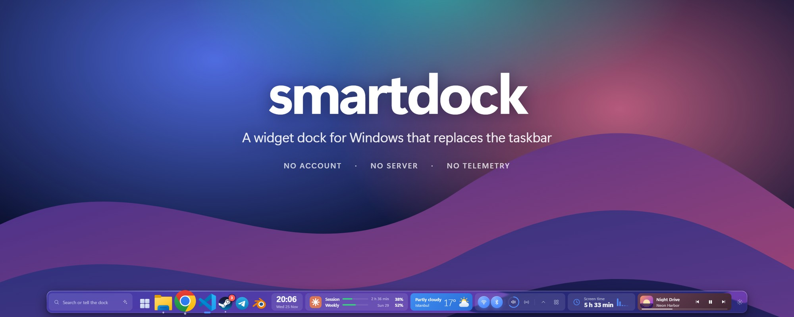
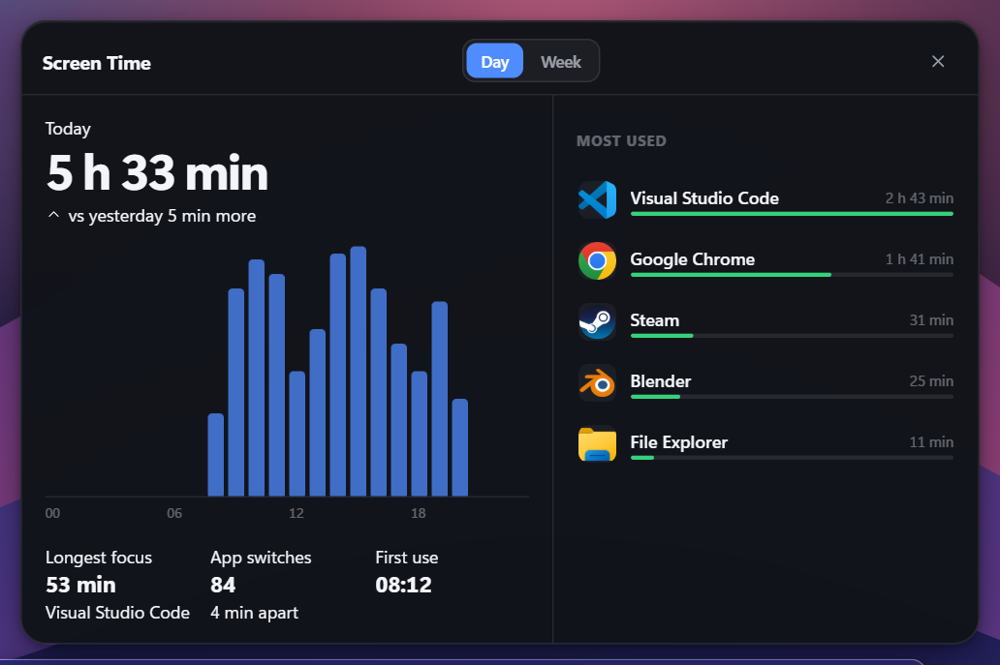

<p align="center">
  <a href="README.md"></a>
  <a href="README.tr.md"></a>
</p>

<p align="center">
  
</p>

<p align="center">
  <a href="../../releases/latest"></a>
  <a href="../../releases"></a>
  
  <a href="LICENSE"></a>
</p>

<p align="center">
  <a href="../../releases/latest"><b>Download</b></a> · <a href="#build-from-source">Build from source</a>
</p>

<p align="center">
  
</p>

## Features

| | |
|---|---|
| **Replaces the taskbar** | Start button, pinned and running apps, magnification, unread badges, window previews |
| **39 widgets** | Clocks and calendar, weather, system stats, quick settings, media, productivity, finance, GitHub |
| **AI usage limits** | Usage limits for Claude, ChatGPT/Codex and Antigravity |
| **Smart search** | `Alt+Space` for apps, files, math, currency conversion and optional AI answers |
| **Five styles** | Midnight, Liquid Glass, iOS, Black and White, with your own accent color |
| **Private** | No account, no server, no telemetry |

## Widgets

Every widget can be added, removed, reordered and resized.


## Panels

<table>
  <tr><td colspan="2" align="center"></td></tr>
  <tr>
    <td width="50%" align="center" valign="top"></td>
    <td width="50%" align="center" valign="top"></td>
  </tr>
</table>

## Styles


## Install

1. Download `smartdock_x.y.z_x64-setup.exe` from [Releases](../../releases).
2. Run it. The file is unsigned, so Windows SmartScreen may warn you: **More info → Run anyway**.
3. If WebView2 is missing, the installer downloads it (internet required).

Settings live in `%APPDATA%\app.smartdock.dock\`. Delete that folder after uninstalling to reset everything.

## Usage

| Action | What it does |
|---|---|
| Right-click → **Resize...** | Sets each widget's scale and width |
| Right-click → **Widgets...** | Adds or removes widgets; drag to reorder in edit mode |
| Bottom-right corner | Shows the desktop / restores windows |
| **Gear button** (end of the dock) | Settings: style, position, auto-hide, hiding the taskbar and more. Click elsewhere to close |

The UI follows your Windows language (English or Turkish); change it under **Settings › Appearance › Language**.

## Build from source

You need [Rust](https://rustup.rs), [Node.js](https://nodejs.org) 18+ and Visual Studio C++ Build Tools.

```powershell
npm install
npx tauri dev                 # development
npx tauri build --no-bundle   # exe only (src-tauri\target\release\smartdock.exe)
powershell -ExecutionPolicy Bypass -File scripts\build-portable.ps1   # shareable installer -> dist\
```

`build-portable.ps1` strips the build machine's user name and folder paths from the exe and verifies it. Use it for installers you share.

Built with Tauri (Rust) and plain HTML/CSS/JS:

- `ui/`: interface (`main.js` dock and layout, `widgets.js` widgets, `apps.js` app strip, `settings.js` settings)
- `src-tauri/src/`: Windows side (windows, appbar/work area, auto-hide, tray, media, sensors)

To add a language, create a file like `ui/js/lang/en.js` and add it to the list in `ui/js/i18n.js`.

## Privacy and network access

The app runs on your own computer. These are its only outgoing requests:

| What | Where | When |
|---|---|---|
| Weather, city search | open-meteo.com | Weather widget is on |
| Approximate location (from IP) | freeipapi.com, get.geojs.io, ipwho.is | Only if no city is set in Settings |
| Crypto prices | coingecko.com | Crypto widget is on |
| Exchange rates | open.er-api.com | Currency widget, or a conversion in search |
| GitHub contribution graph | github-contributions-api.jogruber.de | GitHub widget is on |
| AI answer (search box) | text.pollinations.ai | AI enabled in Settings; only the question you type is sent |
| Update check | api.github.com | Update check enabled in Settings |
| Claude usage limit | Anthropic, through Claude Code | Local records are read first. When they are old, the official `claude -p /usage` command is run (free, no model call); the dock never reads your login key |
| ChatGPT/Codex usage limit | chatgpt.com | Codex widget added, using the Codex session on that computer |

## Releasing

Pushing a tag that starts with `v` makes GitHub Actions build the installer and attach it to the release:

```powershell
git tag vX.Y.Z
git push origin vX.Y.Z
```

Bump the version in `src-tauri/tauri.conf.json` and `src-tauri/Cargo.toml` first. Signing rules: [CODE_SIGNING.md](CODE_SIGNING.md).

## License

[MIT](LICENSE)
