<p align="center">
  <a href="README.md"></a>
  <a href="README.tr.md"></a>
</p>

<p align="center">
  
</p>

<p align="center">
  <a href="../../releases/latest"></a>
  <a href="../../releases"></a>
  
  
  <a href="LICENSE"></a>
</p>

<p align="center">
  <a href="../../releases/latest"><b>Download</b></a> ·
  <a href="#widgets">Widgets</a> ·
  <a href="#panels">Panels</a> ·
  <a href="#install">Install</a> ·
  <a href="#build-from-source">Build from source</a>
</p>

smartdock puts a single bar at the bottom of your screen: a Start button, pinned and running apps, and the widgets you choose. You can see the clock, weather, AI usage limits, system load and the song that's playing without opening anything. Click a widget and a panel opens with the details.

<p align="center">
  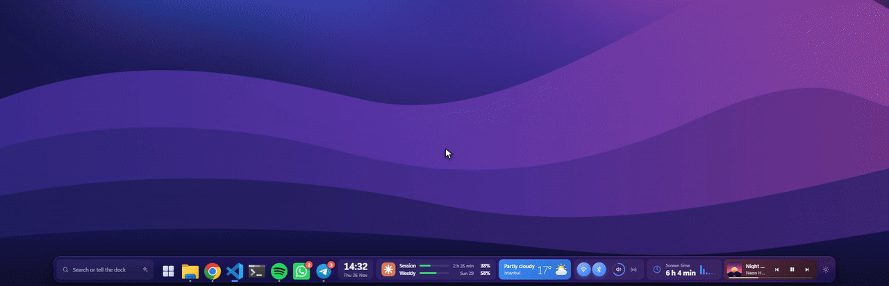
</p>

## Highlights

| | |
|---|---|
| **Replaces the taskbar** | Start button, pinned and running apps, window previews, unread badges, adjustable Mac-style magnification |
| **39 widgets** | Clocks and calendar, weather, AI limits, system, quick settings, music, productivity, finance, GitHub |
| **AI usage at a glance** | Claude and ChatGPT/Codex session and weekly limits, a pace marker, and a weekly forecast that says whether the week will last |
| **Smart search** | `Alt+Space` from anywhere: apps, files, math, currency, and optional AI answers |
| **Five styles** | Midnight, Liquid Glass, iOS, Black and White, plus an accent color and saved looks (profiles) |
| **Fits your setup** | Floating or full-width taskbar shape, top or bottom edge, any display, Smart or Always auto-hide |
| **Light on resources** | Polls only what's on screen; about 2% of one CPU core when idle (see [Performance](#performance)) |
| **Private** | No account, no server, no telemetry |

## Widgets

Every widget can be added, removed, reordered and resized: right-click the dock → **Widgets...** / **Resize...**.

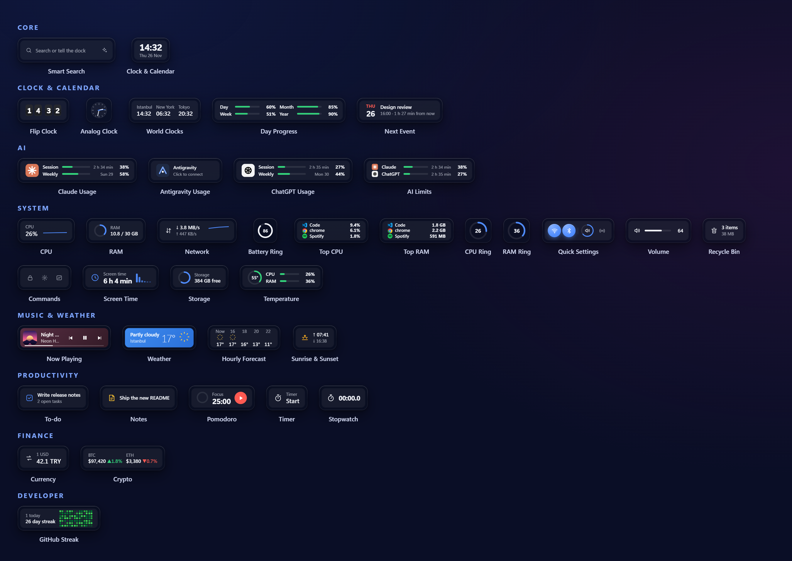

<details>
<summary><b>Full list</b></summary>

| Category | Widgets |
|---|---|
| Core | Smart Search, Apps (Start, pinned, running), Clock & Calendar |
| Clock & Calendar | Flip Clock, Analog Clock, World Clocks, Day Progress, Next Event |
| AI | Claude Usage, ChatGPT Usage, Antigravity Usage, AI Limits (two plans in one tile) |
| System | CPU, RAM, Network, Battery Ring, CPU Ring, RAM Ring, Top CPU, Top RAM, Temperature, Storage, Screen Time, Quick Settings, Volume, Recycle Bin, Commands |
| Music & Weather | Now Playing, Weather, Hourly Forecast, Sunrise & Sunset |
| Productivity | To-do, Notes, Pomodoro, Timer, Stopwatch |
| Finance | Currency, Crypto |
| Developer | GitHub Streak |

</details>

## Panels

Click a widget to open its panel.

<table>
  <tr>
    <td width="33%" align="center" valign="top">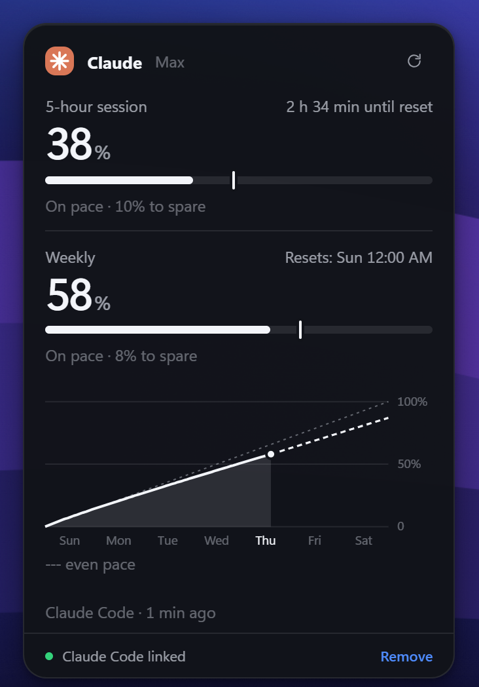<br><sub><b>AI usage</b>: pace and weekly forecast</sub></td>
    <td width="33%" align="center" valign="top">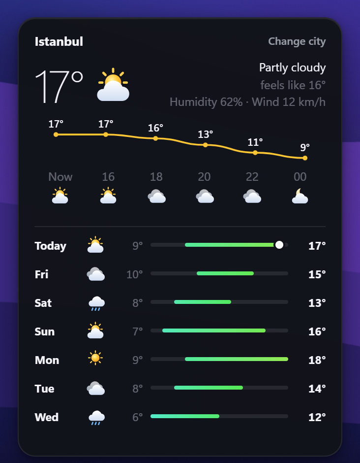<br><sub><b>Weather</b>: hourly curve and 7 days</sub></td>
    <td width="33%" align="center" valign="top">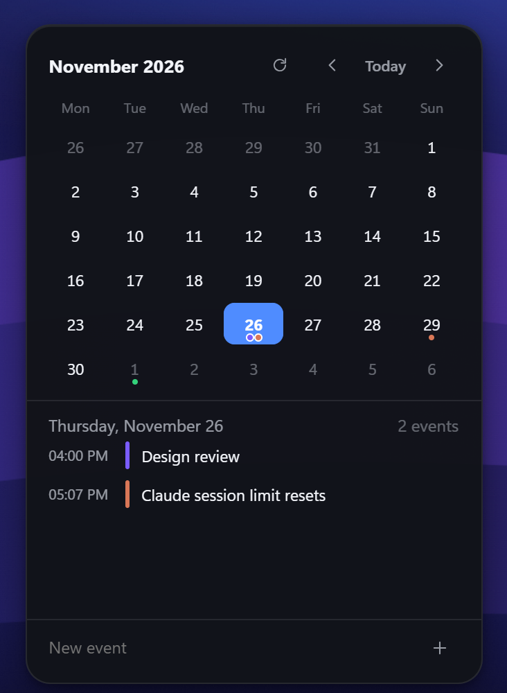<br><sub><b>Calendar</b>: month view and agenda</sub></td>
  </tr>
  <tr>
    <td colspan="2" align="center" valign="top"><br><sub><b>Screen time</b>: today, this week, per app</sub></td>
    <td align="center" valign="top">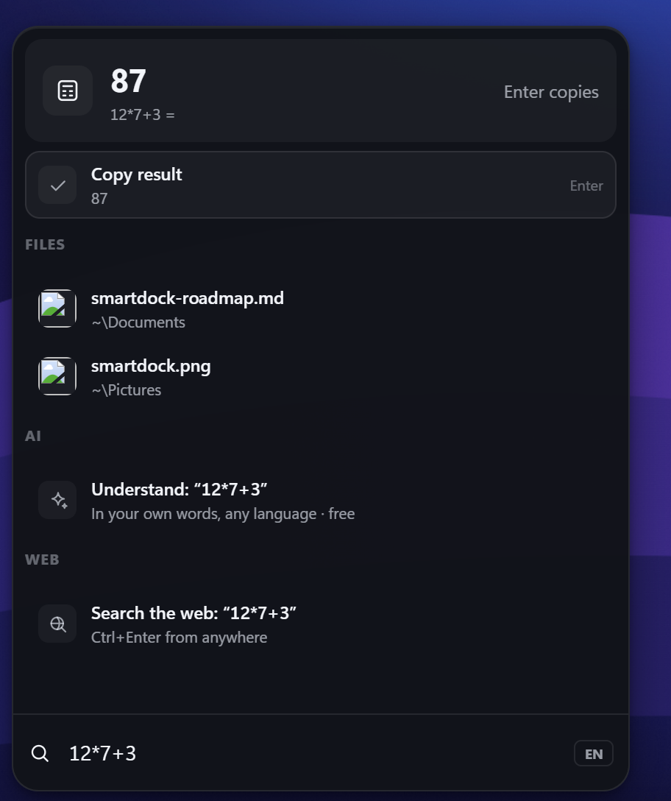<br><sub><b>Search</b>: <code>Alt+Space</code></sub></td>
  </tr>
  <tr>
    <td align="center" valign="top">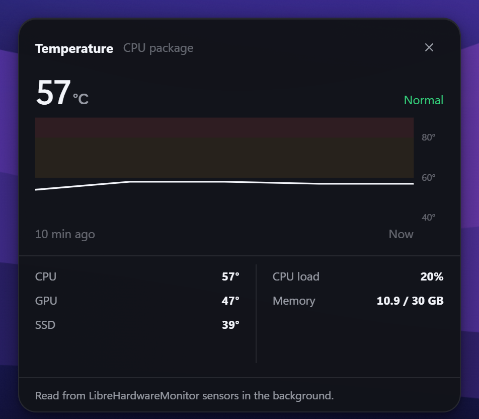<br><sub><b>Temperature</b>: 10-minute history</sub></td>
    <td align="center" valign="top">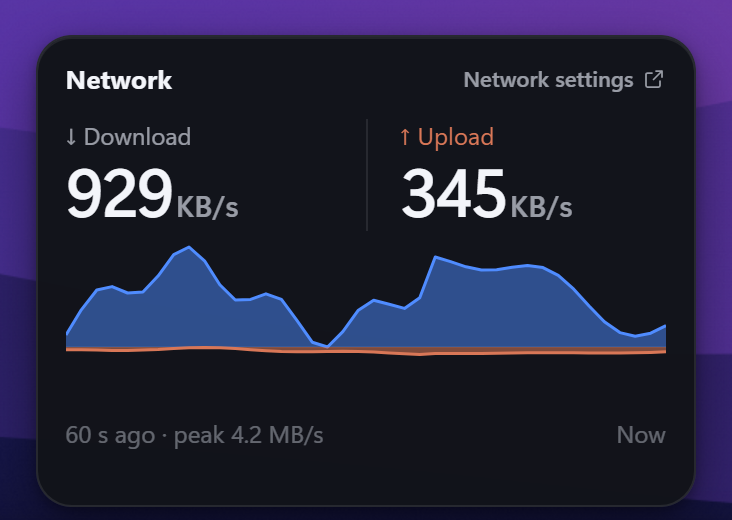<br><sub><b>Network</b>: last minute</sub><br><br>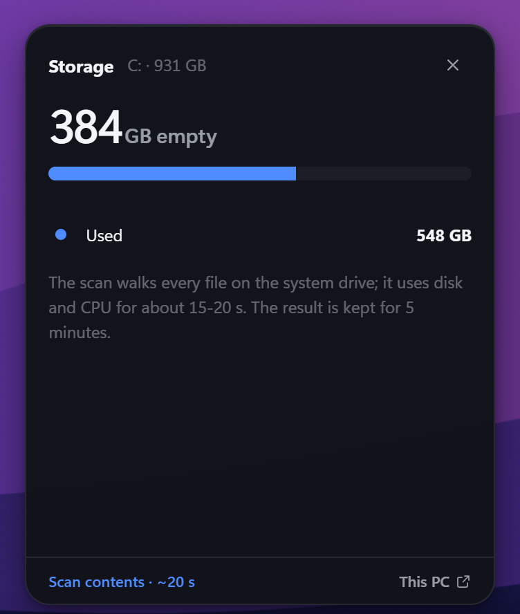<br><sub><b>Storage</b>: what fills the drive</sub></td>
    <td align="center" valign="top">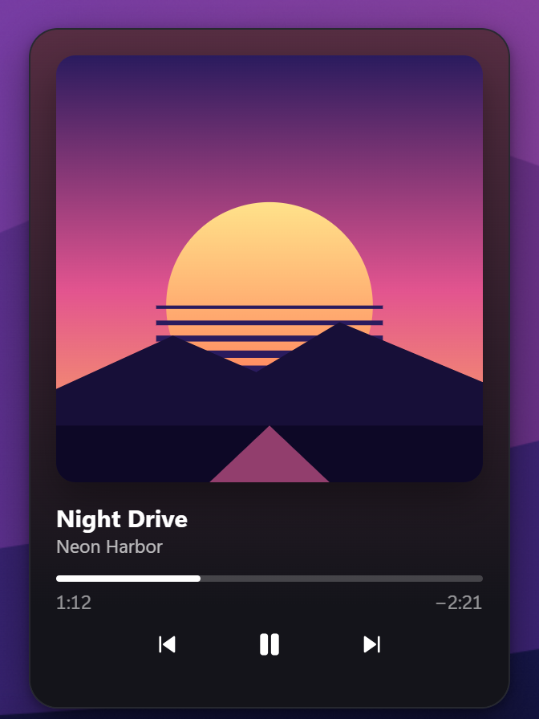<br><sub><b>Now playing</b>: any media app</sub></td>
  </tr>
</table>

### AI usage limits

Each AI widget shows two bars: the 5-hour session and the weekly limit. A tick on each bar marks where an even pace would be by now, so a bar past its tick is being used too fast. The panel adds a chart of this week so far. It projects the week's end from the usage recorded this week, blended with your usual pace from up to four earlier weeks, and says plainly whether the limit will last (or roughly when it runs out). Claude is read from Claude Code or the Claude desktop app, and ChatGPT from the Codex CLI session on the same computer. The dock never reads your login key. Antigravity has no official quota API, so the dock doesn't read it.

## Settings

Settings open from the gear at the end of the dock. Everything fits on one screen with two columns and no scrolling. There's a search box (`Ctrl+F`), and the dock previews each change as you make it. A look you like can be saved as a profile and applied again with one click.

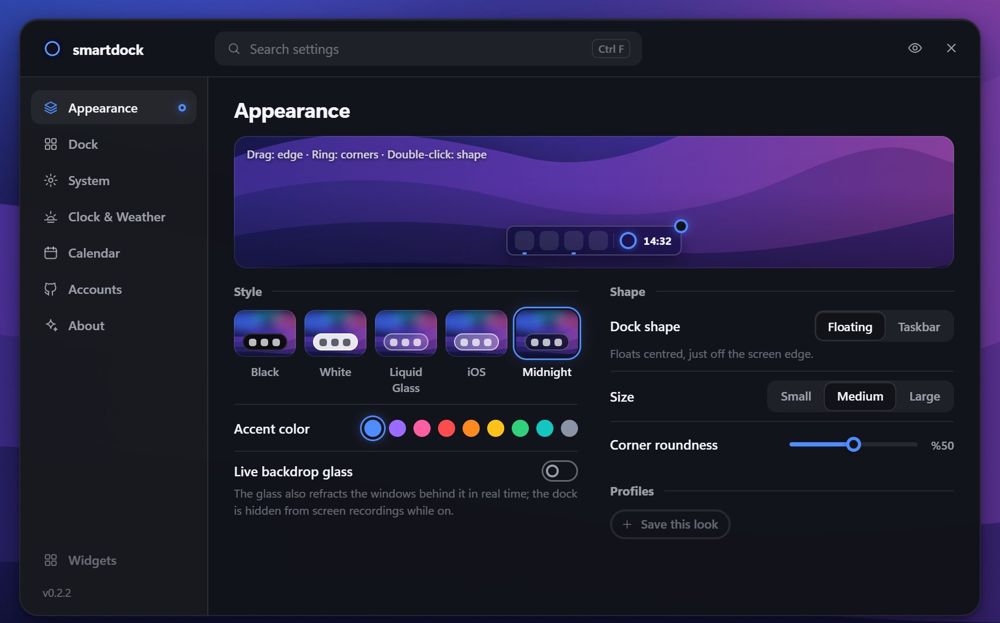

## Styles

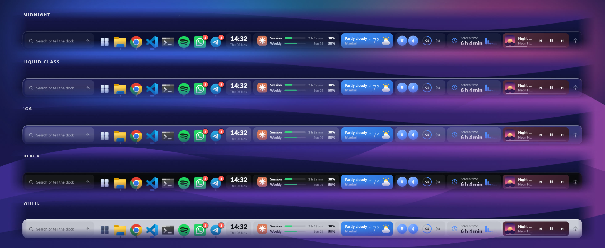

Liquid Glass and iOS bend the wallpaper at the dock's edge with a real refraction map rather than a plain blur. With **Live backdrop glass** on, they also refract the windows behind the dock.

## Install

1. Download `smartdock_x.y.z_x64-setup.exe` from [Releases](../../releases/latest).
2. Run it. The installer isn't signed yet, so SmartScreen may warn you: **More info → Run anyway**.
3. If WebView2 is missing, the installer downloads it (needs internet).

Settings live in `%APPDATA%\app.smartdock.dock\`. Updating keeps them. Uninstalling brings the Windows taskbar back; delete that folder too if you want to reset everything.

## Usage

| Action | What it does |
|---|---|
| Click a widget | Opens its panel; click again or press `Esc` to close |
| Right-click → **Widgets...** | Add or remove widgets; drag to reorder in edit mode |
| Right-click → **Resize...** | Set each widget's scale and width |
| `Alt+Space` | Search from anywhere (change it in **Settings › System**) |
| Hover an app | Window preview; click to switch, click again to minimize |
| Bottom-right corner | Show the desktop / bring the windows back |
| Gear at the end of the dock | Settings. You can hide the gear; settings stay in the right-click menu |

The UI follows your Windows language (English or Turkish). You can change it under **Settings › System**.

## Performance

smartdock only polls the data the visible widgets need, and stops when a widget is removed. Most system reads run in Rust, and work that doesn't change is cached. After 20 seconds idle, the dock lets WebView2 trim its memory.

Measured on a 6-core Windows 11 PC with the default widgets, sitting idle:

| | |
|---|---|
| CPU | about 2% of one core, all processes together (dock + WebView2) |
| Memory | about 150 MB working set across all processes |
| Disk | screen time is saved only when it changed, not every minute |

## Privacy and network access

Everything runs on your computer. These are the only requests it makes:

| What | Where | When |
|---|---|---|
| Weather, city search | open-meteo.com | Weather widget is on |
| Approximate location (from IP) | get.geojs.io, freeipapi.com, ipwho.is | Only if no city is set in Settings |
| Crypto prices | coingecko.com | Crypto widget is on |
| Exchange rates | open.er-api.com | Currency widget, or a conversion in search |
| GitHub contribution graph | github-contributions-api.jogruber.de | GitHub widget is on |
| AI answer in search | text.pollinations.ai | Free AI is on in Settings. Only the question you type is sent, after a one-time notice |
| Update check | api.github.com | Update check is on in Settings |
| Claude usage | Anthropic, through Claude Code | Local records are read first. If they're old, the official `claude -p /usage` command runs (free, no model call) |
| ChatGPT/Codex usage | chatgpt.com | Codex widget added, using the Codex session on that computer |

## Build from source

You need [Rust](https://rustup.rs), [Node.js](https://nodejs.org) 18+ and the Visual Studio C++ Build Tools.

```powershell
npm install
npx tauri dev                 # development
npx tauri build --no-bundle   # exe only: src-tauri\target\release\smartdock.exe
powershell -ExecutionPolicy Bypass -File scripts\build-portable.ps1   # shareable installer -> dist\
```

`build-portable.ps1` removes the build machine's user name and folder paths from the exe and checks the result. Use it for any installer you share.

| Folder | What's in it |
|---|---|
| `ui/js/main.js` | Dock layout, geometry, auto-hide, edit mode |
| `ui/js/widgets.js` | Widget registry and panels |
| `ui/js/data.js` | Data services (polled only while subscribed), weekly forecast |
| `ui/js/apps.js` · `settings.js` · `search.js` | App strip, settings, search |
| `src-tauri/src/` | Windows side: windows, appbar and work area, auto-hide, tray, media, sensors, notifications |

The UI never talks to Windows directly. It calls Rust commands, and native changes come back as events that the widgets subscribe to.

To add a language, copy `ui/js/lang/en.js`, translate the values and add the file to `ui/js/i18n.js`.

## Releasing

Pushing a tag that starts with `v` makes GitHub Actions build the installer and attach it to a release:

```powershell
git tag vX.Y.Z
git push origin vX.Y.Z
```

Bump the version in `src-tauri/tauri.conf.json`, `src-tauri/Cargo.toml` and `package.json` first. Signing: [CODE_SIGNING.md](CODE_SIGNING.md).

## License

[MIT](LICENSE)
