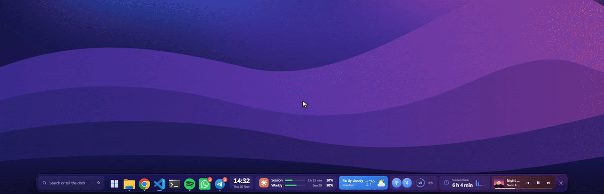
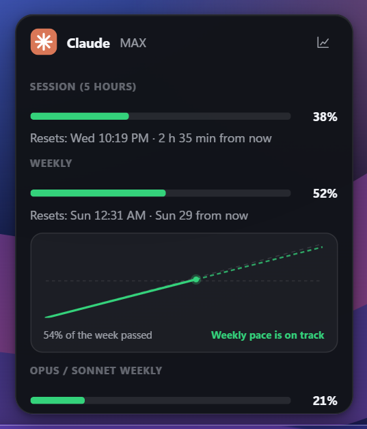

<p align="center">
  <a href="README.md"></a>
  <a href="README.tr.md"></a>
</p>

<p align="center">
  
</p>

<p align="center">
  <a href="../../releases/latest"></a>
  <a href="../../releases"></a>
  
  <a href="LICENSE"></a>
</p>

<p align="center">
  <a href="../../releases/latest"><b>İndir</b></a> · <a href="#kaynaktan-derleme">Kaynaktan derle</a>
</p>

<p align="center">
  
</p>

Tauri (Rust) ve sade HTML/CSS/JS ile yazıldı. Hesap yok, sunucu yok, telemetri yok.

## Widget'lar

Her widget eklenip çıkarılabilir, sıralanabilir ve boyutlandırılabilir.


## Paneller

<table>
  <tr><td colspan="2" align="center"></td></tr>
  <tr>
    <td width="50%" align="center" valign="top"></td>
    <td width="50%" align="center" valign="top"></td>
  </tr>
</table>

## Stiller


## Kurulum (derlemeden)

1. [Releases](../../releases) sayfasından `smartdock_x.y.z_x64-setup.exe` dosyasını indir.
2. Çalıştır. Dosya imzasız olduğu için Windows SmartScreen uyarı verebilir: **Ek bilgi → Yine de çalıştır**.
3. WebView2 yoksa kurulum onu kendisi indirir (internet gerekir).

Ayarlar `%APPDATA%\app.smartdock.dock\` klasöründe tutulur. Kaldırınca bu klasörü silersen her şey sıfırlanır.

## Kullanım

- **Sağ tık → Boyutlandır...**: Her widget'ın ölçeğini ve genişliğini ayrı ayrı ayarlar.
- **Sağ tık → Widget'lar...**: Widget ekler/çıkarır. Düzenleme modunda widget'lar sürüklenerek sıralanır.
- **Sağ alt köşe**: Masaüstünü gösterir / pencereleri geri getirir.
- **Dişli düğmesi** (dock'un sonunda): Ayarlar (stil, konum, otomatik gizleme, görev çubuğunu gizleme ve diğerleri). Başka yere tıklayınca kapanır.

## Kaynaktan derleme

Gerekenler: [Rust](https://rustup.rs), [Node.js](https://nodejs.org) 18+, Visual Studio C++ Build Tools.

```powershell
npm install
npx tauri dev                 # geliştirme
npx tauri build --no-bundle   # sadece exe (src-tauri\target\release\smartdock.exe)
powershell -ExecutionPolicy Bypass -File scripts\build-portable.ps1   # paylaşılabilir kurulum dosyası -> dist\
```

`build-portable.ps1`, derleme makinesinin kullanıcı adını ve klasör yollarını exe'den temizler ve kontrol eder. Paylaşacağın kurulum dosyalarını bununla üret.

Proje yapısı:

- `ui/`: Arayüz (`main.js` dock ve yerleşim, `widgets.js` widget'lar, `apps.js` uygulama şeridi, `settings.js` ayarlar).
- `src-tauri/src/`: Windows tarafı (pencereler, appbar/çalışma alanı, otomatik gizleme, tepsi, medya, sensörler).

## Gizlilik ve ağ erişimi

Uygulama yalnız kendi bilgisayarında çalışır. Dışarıya sadece şu istekleri atar:

| Ne | Nereye | Ne zaman |
|---|---|---|
| Hava durumu, şehir arama | open-meteo.com | Hava durumu widget'ı açıksa |
| Yaklaşık konum (IP'den) | freeipapi.com, get.geojs.io, ipwho.is | Sadece Ayarlar'da şehir seçilmemişse |
| Kripto fiyatları | coingecko.com | Kripto widget'ı açıksa |
| Döviz kurları | open.er-api.com | Döviz widget'ı veya arama kutusunda çeviri yapılınca |
| GitHub katkı grafiği | github-contributions-api.jogruber.de | GitHub widget'ı açıksa |
| Yapay zekâ cevabı (arama kutusu) | text.pollinations.ai | Ayarlar'da yapay zekâ açıksa, sadece arama kutusuna yazılan soru gönderilir |
| Güncelleme denetimi | api.github.com | Ayarlar'da güncelleme denetimi açıksa |
| Claude kullanım limiti | Anthropic, Claude Code üzerinden | Önce yerel kayıtlar okunur. Eskiyse resmî `claude -p /usage` komutu çalıştırılır (ücretsiz, modele istek gitmez); dock giriş anahtarını okumaz |
| ChatGPT/Codex kullanım limiti | chatgpt.com | Codex widget'ı eklenmişse, o bilgisayardaki Codex oturumuyla |

## Dil

Arayüz Windows diline göre Türkçe ya da İngilizce açılır; Ayarlar › Görünüm › Dil'den değiştirilir. Çeviriler `ui/js/lang/en.js` dosyasında: anahtar Türkçe metin, değer çevirisi. Yeni dil eklemek için aynı yapıda bir dosya açıp `ui/js/i18n.js` içindeki listeye eklemek yeterli.

## Sürüm yayınlama

`v` ile başlayan bir etiket gönderince GitHub Actions kurulum dosyasını GitHub'ın kendi sunucusunda derleyip sürüme ekler:

```powershell
git tag vX.Y.Z
git push origin vX.Y.Z
```

Önce `src-tauri/tauri.conf.json` ve `src-tauri/Cargo.toml` içindeki sürümü yükselt. İmzalama kuralları için [CODE_SIGNING.md](CODE_SIGNING.md).

## Lisans

[MIT](LICENSE)
