<p align="center">
  <a href="README.md"></a>
  <a href="README.tr.md"></a>
</p>

<p align="center">
  
</p>

<p align="center">
  <a href="../../releases/latest"></a>
  <a href="../../releases"></a>
  
  
  <a href="LICENSE"></a>
</p>

<p align="center">
  <a href="../../releases/latest"><b>İndir</b></a> ·
  <a href="#widgetlar">Widget'lar</a> ·
  <a href="#paneller">Paneller</a> ·
  <a href="#kurulum">Kurulum</a> ·
  <a href="#kaynaktan-derleme">Kaynaktan derleme</a>
</p>

smartdock ekranın altına tek bir çubuk koyar: Başlat düğmesi, sabitlenmiş ve açık uygulamalar ve seçtiğin widget'lar. Saati, havayı, yapay zekâ limitlerini, sistem yükünü ve çalan şarkıyı hiçbir şey açmadan görürsün. Bir widget'a tıklayınca ayrıntıların olduğu panel açılır.

<p align="center">
  
</p>

## Öne çıkanlar

| | |
|---|---|
| **Görev çubuğunun yerine geçer** | Başlat düğmesi, sabitlenmiş ve açık uygulamalar, pencere önizlemesi, okunmamış rozetleri, ayarlanabilir Mac tarzı büyütme |
| **39 widget** | Saat ve takvim, hava, yapay zekâ limitleri, sistem, hızlı ayarlar, müzik, üretkenlik, finans, GitHub |
| **Yapay zekâ kullanımı bir bakışta** | Claude ve ChatGPT/Codex oturum ve haftalık limitleri, tempo çizgisi ve haftanın yetip yetmeyeceğini söyleyen haftalık tahmin |
| **Akıllı arama** | Her yerden `Alt+Space`: uygulamalar, dosyalar, hesap makinesi, döviz ve isteğe bağlı yapay zekâ yanıtları |
| **Beş stil** | Gece, Sıvı Cam, iOS, Siyah ve Beyaz; vurgu rengi ve kaydedilen görünümler (profiller) |
| **Düzenine uyar** | Yüzen ya da tam genişlik görev çubuğu biçimi, alt ya da üst kenar, istediğin ekran, Akıllı ya da Her zaman otomatik gizleme |
| **Kaynaklara hafif** | Yalnız ekrandakinin verisini çeker; boştayken tek çekirdeğin yaklaşık %2'si ([Performans](#performans)) |
| **Gizli** | Hesap yok, sunucu yok, telemetri yok |

## Widget'lar

Her widget eklenip çıkarılabilir, sıralanabilir ve boyutlandırılabilir: dock'a sağ tıkla → **Widget'lar...** / **Boyutlandır...**.

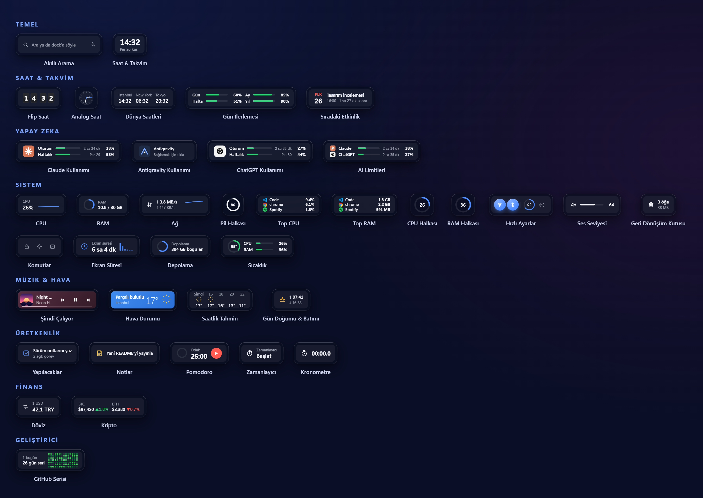

<details>
<summary><b>Tam liste</b></summary>

| Kategori | Widget'lar |
|---|---|
| Temel | Akıllı Arama, Uygulamalar (Başlat, sabitlenmiş, açık), Saat & Takvim |
| Saat & Takvim | Flip Saat, Analog Saat, Dünya Saatleri, Gün İlerlemesi, Sıradaki Etkinlik |
| Yapay Zekâ | Claude Kullanımı, ChatGPT Kullanımı, Antigravity Kullanımı, AI Limitleri (iki plan tek tile'da) |
| Sistem | CPU, RAM, Ağ, Pil Halkası, CPU Halkası, RAM Halkası, Top CPU, Top RAM, Sıcaklık, Depolama, Ekran Süresi, Hızlı Ayarlar, Ses Seviyesi, Geri Dönüşüm Kutusu, Komutlar |
| Müzik & Hava | Şimdi Çalıyor, Hava Durumu, Saatlik Tahmin, Gün Doğumu & Batımı |
| Üretkenlik | Yapılacaklar, Notlar, Pomodoro, Zamanlayıcı, Kronometre |
| Finans | Döviz, Kripto |
| Geliştirici | GitHub Serisi |

</details>

## Paneller

Bir widget'a tıklayınca paneli açılır.

<table>
  <tr>
    <td width="33%" align="center" valign="top">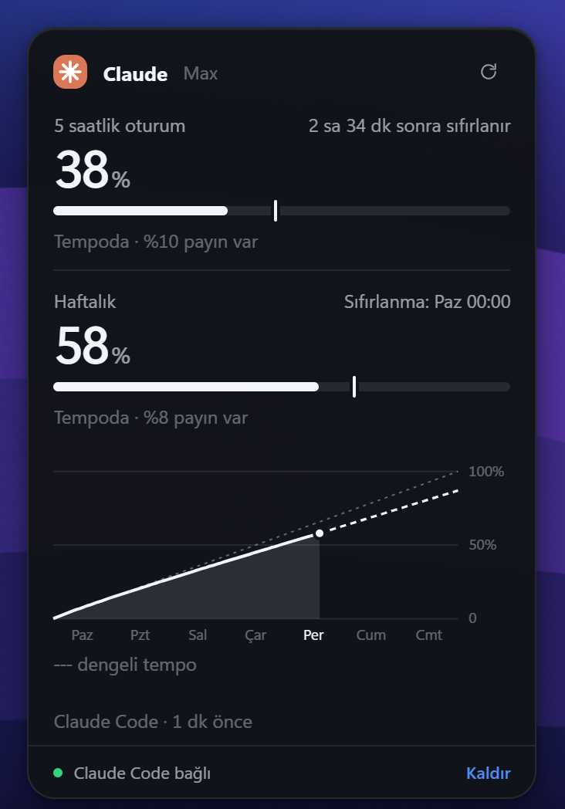<br><sub><b>Yapay zekâ kullanımı</b>: tempo ve haftalık tahmin</sub></td>
    <td width="33%" align="center" valign="top">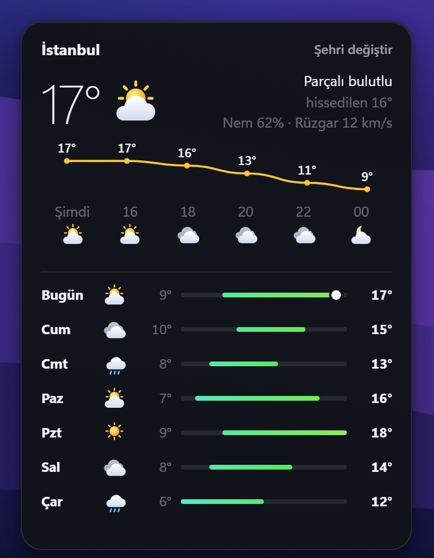<br><sub><b>Hava durumu</b>: saatlik eğri ve 7 gün</sub></td>
    <td width="33%" align="center" valign="top">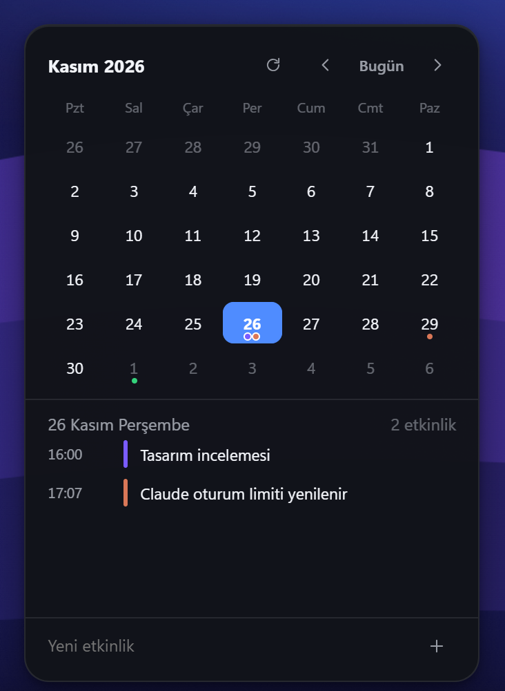<br><sub><b>Takvim</b>: ay görünümü ve ajanda</sub></td>
  </tr>
  <tr>
    <td colspan="2" align="center" valign="top">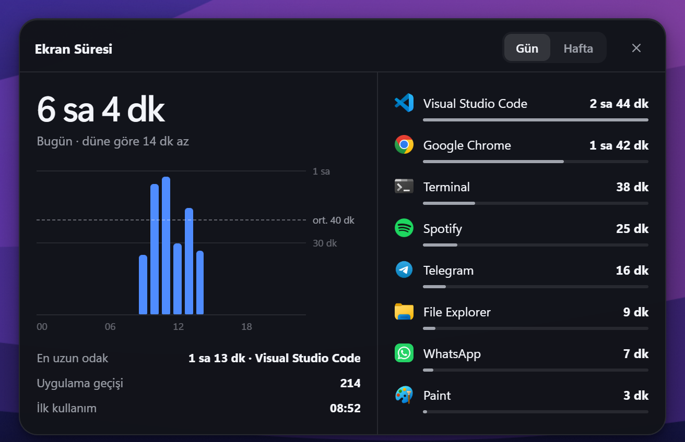<br><sub><b>Ekran süresi</b>: bugün, bu hafta, uygulama uygulama</sub></td>
    <td align="center" valign="top">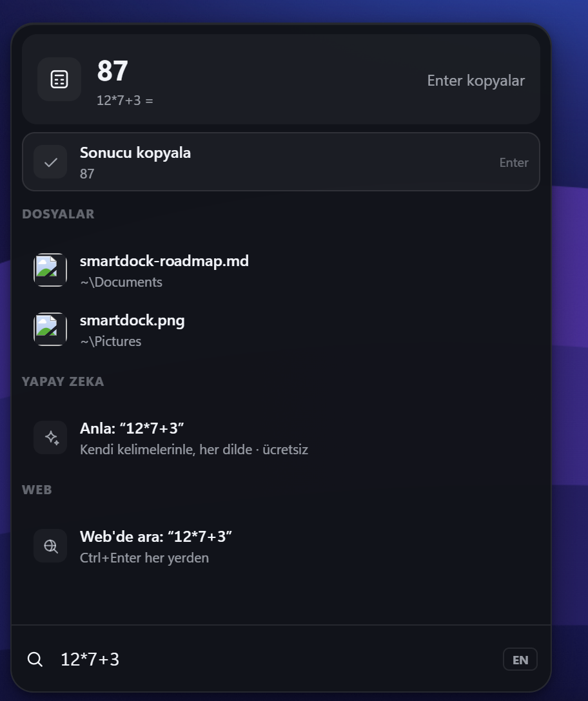<br><sub><b>Arama</b>: <code>Alt+Space</code></sub></td>
  </tr>
  <tr>
    <td align="center" valign="top">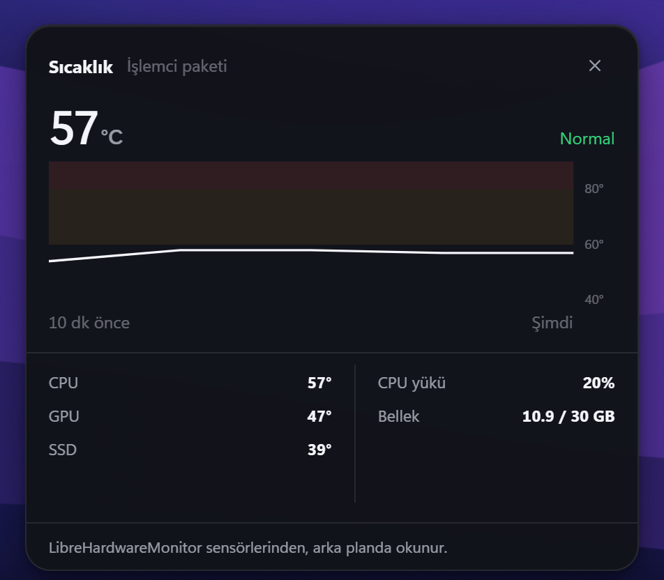<br><sub><b>Sıcaklık</b>: 10 dakikalık geçmiş</sub></td>
    <td align="center" valign="top">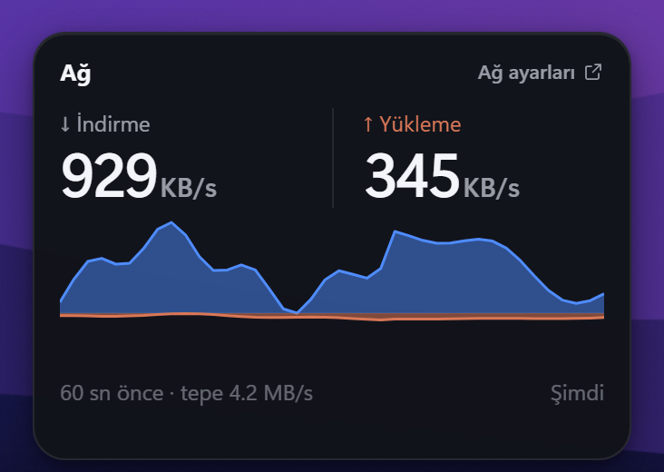<br><sub><b>Ağ</b>: son bir dakika</sub><br><br>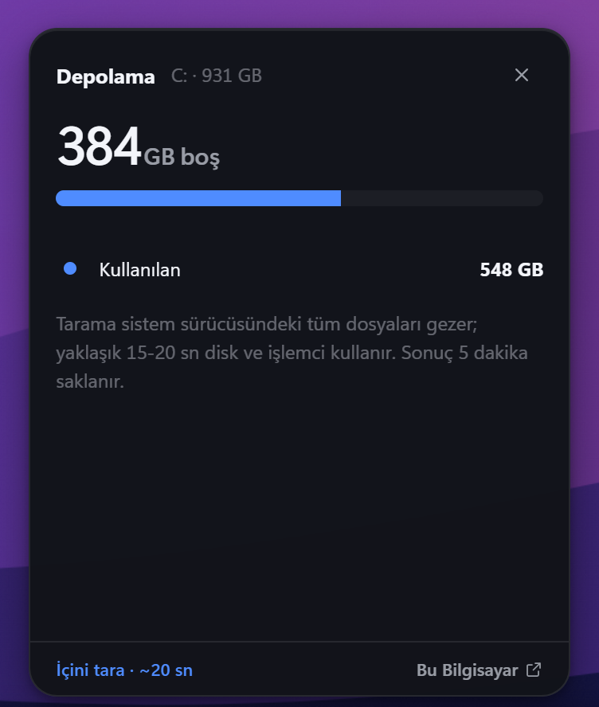<br><sub><b>Depolama</b>: diski ne dolduruyor</sub></td>
    <td align="center" valign="top">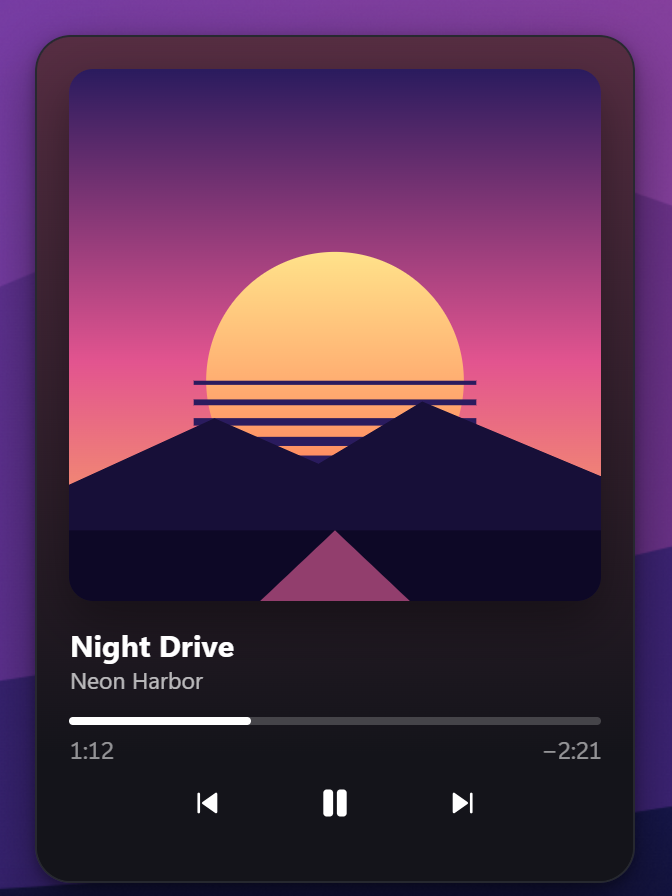<br><sub><b>Şimdi çalıyor</b>: her medya uygulaması</sub></td>
  </tr>
</table>

### Yapay zekâ kullanım limitleri

Her yapay zekâ widget'ında iki çubuk vardır: 5 saatlik oturum ve haftalık limit. Çubuktaki çizgi, eşit hızla kullansan şu an nerede olacağını gösterir; çizgiyi geçen çubuk hızlı gidiyor demektir. Panelde bu haftanın grafiği de vardır. Hafta sonunu, bu haftanın kayıtlarına önceki dört haftaya kadarki olağan temponu katarak tahmin eder ve limitin yetip yetmeyeceğini (yetmeyecekse yaklaşık ne zaman biteceğini) açıkça söyler. Claude, Claude Code'dan ya da Claude masaüstü uygulamasından; ChatGPT ise aynı bilgisayardaki Codex CLI oturumundan okunur. Dock giriş anahtarını hiçbir zaman okumaz. Antigravity'nin resmî bir kota API'si olmadığı için dock onu okumaz.

## Ayarlar

Ayarlar, dock'un sonundaki dişliden açılır. Her şey iki sütunlu tek bir ekrana sığar, kaydırma yoktur. Bir arama kutusu (`Ctrl+F`) vardır ve dock her değişikliği sen yaparken gösterir. Beğendiğin bir görünümü profil olarak kaydedip tek tıkla geri getirebilirsin.

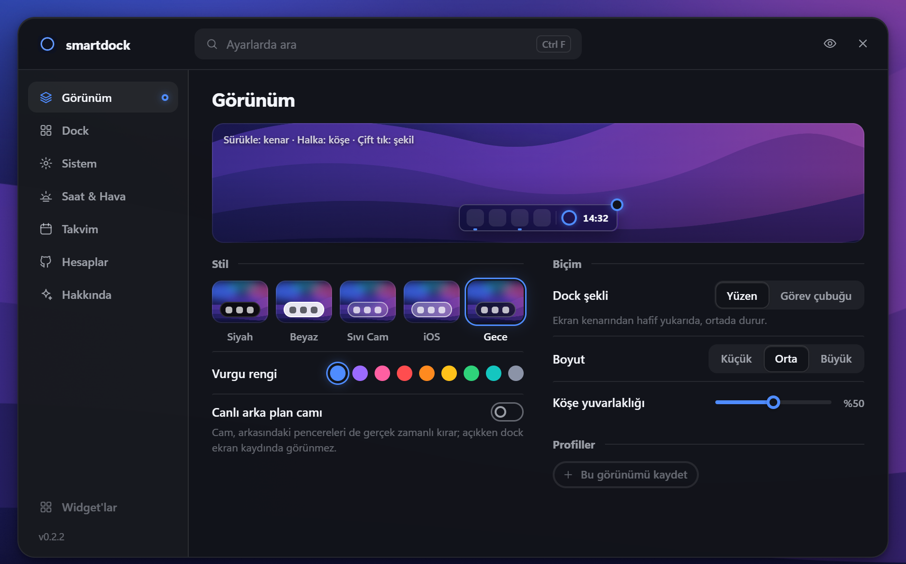

## Stiller

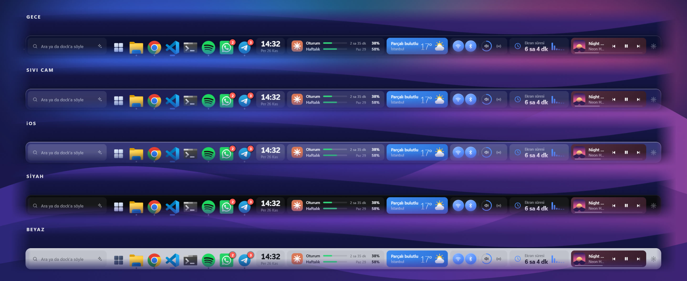

Sıvı Cam ve iOS, duvar kağıdını düz bir bulanıklık yerine gerçek bir kırılma haritasıyla dock'un kenarında büker. **Canlı arka plan camı** açıkken dock'un arkasındaki pencereleri de kırarlar.

## Kurulum

1. [Releases](../../releases/latest) sayfasından `smartdock_x.y.z_x64-setup.exe` dosyasını indir.
2. Çalıştır. Kurulum dosyası henüz imzalı değil, bu yüzden SmartScreen uyarabilir: **Ek bilgi → Yine de çalıştır**.
3. WebView2 eksikse kurulum onu indirir (internet gerekir).

Ayarlar `%APPDATA%\app.smartdock.dock\` klasöründe durur ve güncellemede korunur. Kaldırınca Windows görev çubuğu geri gelir; her şeyi sıfırlamak istersen o klasörü de sil.

## Kullanım

| Eylem | Ne yapar |
|---|---|
| Widget'a tıkla | Panelini açar; kapatmak için yeniden tıkla ya da `Esc` |
| Sağ tık → **Widget'lar...** | Widget ekler ya da çıkarır; düzenleme modunda sürükleyerek sırala |
| Sağ tık → **Boyutlandır...** | Her widget'ın ölçeğini ve genişliğini ayarlar |
| `Alt+Space` | Her yerden arama (**Ayarlar › Sistem**'den değiştirilebilir) |
| Uygulamanın üzerine gel | Pencere önizlemesi; tıklayınca geçer, yeniden tıklayınca küçültür |
| Sağ alt köşe | Masaüstünü gösterir / pencereleri geri getirir |
| Dock'un sonundaki dişli | Ayarlar. Dişliyi gizleyebilirsin; ayarlar sağ tık menüsünde kalır |

Arayüz Windows dilini izler (Türkçe ya da İngilizce). **Ayarlar › Sistem**'den değiştirebilirsin.

## Performans

smartdock yalnız görünen widget'ların ihtiyaç duyduğu veriyi çeker; bir widget kaldırılınca onun sorgusu da durur. Sistem okumalarının çoğu Rust tarafında yapılır ve değişmeyen iş önbellekte tutulur. 20 saniye boşta kalınca dock, WebView2'nin belleğini küçültmesine izin verir.

Varsayılan widget'larla, boşta duran 6 çekirdekli bir Windows 11 bilgisayarda ölçüldü:

| | |
|---|---|
| İşlemci | tüm süreçler birlikte (dock + WebView2) tek çekirdeğin yaklaşık %2'si |
| Bellek | tüm süreçlerde toplam yaklaşık 150 MB çalışma kümesi |
| Disk | ekran süresi her dakika değil, yalnız değiştiğinde kaydedilir |

## Gizlilik ve ağ erişimi

Her şey senin bilgisayarında çalışır. Yaptığı istekler yalnızca bunlardır:

| Ne | Nereye | Ne zaman |
|---|---|---|
| Hava durumu, şehir arama | open-meteo.com | Hava widget'ı açıkken |
| Yaklaşık konum (IP'den) | get.geojs.io, freeipapi.com, ipwho.is | Yalnız Ayarlar'da şehir seçilmemişse |
| Kripto fiyatları | coingecko.com | Kripto widget'ı açıkken |
| Döviz kurları | open.er-api.com | Döviz widget'ı ya da aramada çeviri |
| GitHub katkı grafiği | github-contributions-api.jogruber.de | GitHub widget'ı açıkken |
| Aramada yapay zekâ yanıtı | text.pollinations.ai | Ayarlar'da Ücretsiz AI açıksa. Bir kerelik bilgilendirmeden sonra yalnız yazdığın soru gönderilir |
| Güncelleme denetimi | api.github.com | Ayarlar'da güncelleme denetimi açıksa |
| Claude kullanımı | Claude Code üzerinden Anthropic | Önce yerel kayıtlar okunur. Eskiyse resmî `claude -p /usage` komutu çalışır (ücretsiz, model çağrısı yok) |
| ChatGPT/Codex kullanımı | chatgpt.com | Codex widget'ı ekliyse, o bilgisayardaki Codex oturumuyla |

## Kaynaktan derleme

[Rust](https://rustup.rs), [Node.js](https://nodejs.org) 18+ ve Visual Studio C++ Build Tools gerekir.

```powershell
npm install
npx tauri dev                 # geliştirme
npx tauri build --no-bundle   # yalnız exe: src-tauri\target\release\smartdock.exe
powershell -ExecutionPolicy Bypass -File scripts\build-portable.ps1   # paylaşılabilir kurulum -> dist\
```

`build-portable.ps1`, derleyen makinenin kullanıcı adını ve klasör yollarını exe'den çıkarır ve sonucu denetler. Paylaşacağın her kurulum için onu kullan.

| Klasör | İçinde ne var |
|---|---|
| `ui/js/main.js` | Dock yerleşimi, geometri, otomatik gizleme, düzenleme modu |
| `ui/js/widgets.js` | Widget kaydı ve paneller |
| `ui/js/data.js` | Veri servisleri (yalnız abone varken çekilir), haftalık tahmin |
| `ui/js/apps.js` · `settings.js` · `search.js` | Uygulama şeridi, ayarlar, arama |
| `src-tauri/src/` | Windows tarafı: pencereler, appbar ve çalışma alanı, otomatik gizleme, tepsi, medya, sensörler, bildirimler |

Arayüz Windows'la doğrudan konuşmaz. Rust komutlarını çağırır; yerel değişiklikler widget'ların abone olduğu olaylar olarak geri gelir.

Yeni bir dil eklemek için `ui/js/lang/en.js` dosyasını kopyala, değerleri çevir ve dosyayı `ui/js/i18n.js` listesine ekle.

## Sürüm yayınlama

`v` ile başlayan bir etiket gönderilince GitHub Actions kurulum dosyasını derler ve sürüme ekler:

```powershell
git tag vX.Y.Z
git push origin vX.Y.Z
```

Önce `src-tauri/tauri.conf.json`, `src-tauri/Cargo.toml` ve `package.json` içindeki sürümü yükselt. İmzalama: [CODE_SIGNING.md](CODE_SIGNING.md).

## Lisans

[MIT](LICENSE)
